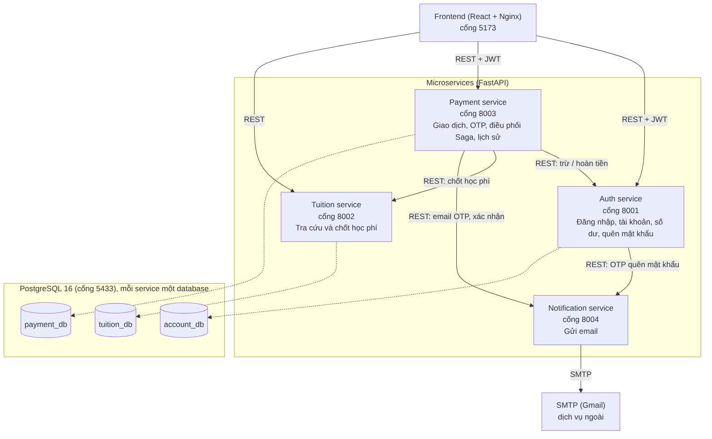
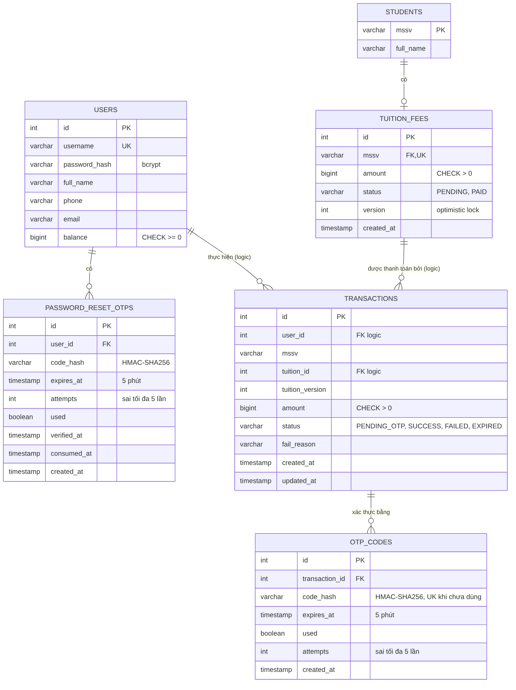

# iBanking - Phân hệ đóng học phí (CS504070)

Ứng dụng mô phỏng thanh toán học phí cho sinh viên TDTU. Người dùng đăng nhập, tra cứu học phí theo MSSV, xác nhận giao dịch bằng OTP gửi qua email, và hệ thống đảm bảo dữ liệu luôn nhất quán khi có nhiều giao dịch xảy ra cùng lúc.

## Chức năng chính

- Đăng nhập bằng username/password (JWT), quên mật khẩu bằng OTP qua email
- Tra cứu học phí theo MSSV, đóng cho chính mình hoặc đóng hộ sinh viên khác
- Xác thực giao dịch bằng OTP (hiệu lực 5 phút, dùng một lần, sai tối đa 5 lần)
- Email xác nhận khi thanh toán thành công: người thanh toán, sinh viên nhận, MSSV, số tiền
- Lịch sử giao dịch
- Xử lý đồng thời: không âm tiền, không đóng học phí hai lần

## Kiến trúc



| Thành phần | Cổng | Vai trò | Database |
|---|---|---|---|
| frontend | 5173 | Giao diện web (React, TypeScript, Redux Toolkit) | - |
| auth-service | 8001 | Đăng nhập, người dùng, số dư, quên mật khẩu | `account_db` |
| tuition-service | 8002 | Tra cứu và chốt trạng thái học phí | `tuition_db` |
| payment-service | 8003 | Tạo giao dịch, OTP, điều phối thanh toán, lịch sử | `payment_db` |
| notification-service | 8004 | Gửi email (OTP, xác nhận thanh toán) | - |
| postgres | 5433 | PostgreSQL 16, 3 database riêng | - |

Sơ đồ dữ liệu (ERD):



Thiết kế REST API: [docs/api-design.md](docs/api-design.md). Kịch bản kiểm thử: [docs/testflow.md](docs/testflow.md).

## Đảm bảo nhất quán dữ liệu

Tài khoản và học phí nằm ở hai database khác nhau nên không dùng chung một transaction được. Payment Service điều phối theo mô hình **Saga có bù trừ**:

1. Khóa dòng giao dịch (`SELECT ... FOR UPDATE`), kiểm tra OTP rồi đánh dấu đã dùng. Bấm xác nhận hai lần chỉ xử lý một lần.
2. Trừ tiền bằng một câu lệnh nguyên tử: `UPDATE users SET balance = balance - :amt WHERE id = :id AND balance >= :amt`. Hai giao dịch song song của cùng tài khoản không thể làm số dư âm.
3. Chốt học phí bằng optimistic locking: `UPDATE tuition_fees SET status='PAID', version=version+1 WHERE status='PENDING' AND version=:v`. Hai người cùng trả một MSSV thì chỉ một người thành công.
4. Nếu bước 3 thất bại thì hoàn tiền (bù trừ) và ghi giao dịch `FAILED`.

## Chạy hệ thống

Yêu cầu: Docker Desktop, các cổng 5173, 5433, 8001-8004 đang trống.

```powershell
git clone <đường-dẫn-repo>
cd Midterm_SOA_ITBanking

Copy-Item .env.example .env
# Mở .env, đổi POSTGRES_PASSWORD, JWT_SECRET, INTERNAL_API_KEY

docker compose up -d --build
docker compose ps
```

Chờ 6 container `running`, rồi mở **http://localhost:5173**. Lần chạy đầu, PostgreSQL tự chạy `database/init.sql` để tạo 3 database và dữ liệu mẫu.

```powershell
docker compose down        # dừng, giữ dữ liệu
docker compose down -v     # dừng và xóa dữ liệu (về trạng thái ban đầu)
```

## Tài khoản và dữ liệu mẫu

Mật khẩu của cả 6 tài khoản: `123456`

| Username | Họ tên | Số dư | MSSV |
|---|---|---|---|
| tan | Nguyen Huu Tan | 20.000.000 | 524H0028 |
| thai | Tran Minh Thai | 5.000.000 | 524H0029 |
| viet | Le Quoc Viet | 30.000.000 | 524H0030 |
| nam | Nguyen Van Nam | 25.000.000 | 524H0032 |
| lan | Pham Thi Lan | 18.000.000 | 524H0033 |
| mai | Hoang Thi Mai | 8.000.000 | 524H0034 |
Mật khẩu của tất cả tài khoản: `123456`

Hệ thống hỗ trợ đăng nhập bằng chính **Họ và tên đầy đủ** (có dấu hoặc không dấu), hoặc **Số điện thoại**, **Email**:

| Tên đăng nhập (Họ tên) | Tên viết tắt | Số điện thoại | Số dư ban đầu | MSSV tương ứng |
|---|---|---|---|---|
| **Nguyễn Hữu Tân** | `tan` | `0901111111` | 20.000.000 | 524H0028 |
| **Trần Minh Thái** | `thai` | `0902222222` | 5.000.000 | 524H0029 |
| **Lê Quốc Việt** | `viet` | `0903333333` | 30.000.000 | 524H0137 |
| **Nguyễn Văn Nam** | `nam` | `0904444444` | 25.000.000 | - |
| **Phạm Thị Lan** | `lan` | `0905555555` | 18.000.000 | - |

Học phí (có thể đóng cho bất kỳ MSSV nào):

| MSSV | Sinh viên | Số tiền | Trạng thái |
|---|---|---|---|
| 524H0028 | Nguyen Huu Tan | 15.000.000 | Chưa đóng |
| 524H0029 | Tran Minh Thai | 12.500.000 | Chưa đóng |
| 524H0030 | Le Quoc Viet | 12.500.000 | Đã đóng |
| 524H0031 | Pham Gia Bao (không có tài khoản) | 18.000.000 | Chưa đóng |
| 524H0032 | Nguyen Van Nam | 14.000.000 | Chưa đóng |
| 524H0033 | Pham Thi Lan | 16.500.000 | Chưa đóng |
| 524H0034 | Hoang Thi Mai | 7.500.000 | Chưa đóng |
| 524H0035 | Do Quang Huy (không có tài khoản) | chưa có khoản học phí | - |
| 524H0028 | Nguyễn Hữu Tân | 15.000.000 | Chưa đóng |
| 524H0029 | Trần Minh Thái | 12.500.000 | Chưa đóng |
| 524H0031 | Phạm Gia Bảo | 18.000.000 | Chưa đóng |
| 524H0137 | Lê Quốc Việt | 12.500.000 | Đã đóng |

## Nhận mã OTP và email

**Mặc định (chưa cấu hình SMTP):** nội dung email in ra log của notification-service.

```powershell
docker compose logs -f notification-service
```

**Gửi email thật qua Gmail:**

1. Đổi email của user mẫu thành email của bạn:
   ```powershell
   docker exec -it ibanking_postgres psql -U postgres -d account_db -c "UPDATE users SET email='email-cua-ban@gmail.com' WHERE username='tan';"
   ```
2. Tạo App Password cho Gmail (cần bật xác minh 2 bước), điền `SMTP_USER` và `SMTP_PASS` vào `.env`.
3. Chạy lại: `docker compose up -d`.

## Kiểm thử

Các bước kiểm thử và kết quả mong đợi: [docs/testflow.md](docs/testflow.md). Đặt lại dữ liệu trước mỗi lần demo:

```powershell
.\tests\reset.ps1
```

## Đối chiếu yêu cầu đề bài

| Yêu cầu | Nơi thực hiện |
|---|---|
| 1. Phân tích nghiệp vụ, Use Case, ERD | `docs/use-case-diagram.docx`, `docs/erd.png` |
| 2. Kiến trúc Microservices | Mục Kiến trúc, `docs/architecture.png` |
| 3. Thiết kế REST API | `docs/api-design.md` |
| 4. Thiết kế và hiện thực CSDL | `database/init.sql` |
| 5. Lập trình service và API | `auth-service/`, `tuition-service/`, `payment-service/`, `notification-service/` |
| 6. Transaction và concurrency | Mục Đảm bảo nhất quán dữ liệu, `payment-service/main.py` |
| 7. Giao diện web | `frontend-tuition/` |
| 8. Tài liệu và trình diễn | README này, `docs/testflow.md` |

## Hạn chế đã biết

- Nếu Payment Service dừng đột ngột sau khi Account Service đã trừ tiền nhưng trước khi chốt học phí, giao dịch có thể bị kẹt và người dùng có thể bị trừ tiền lần hai khi thử lại. Hướng khắc phục: ghi trạng thái `DEBITED` bằng một commit riêng trước khi chốt học phí, kèm job đối soát định kỳ.
- Biến `DEBUG_RETURN_OTP=1` chỉ dùng khi chạy script concurrency (API sẽ trả OTP trong response). Bình thường để `0`.

## Cấu trúc thư mục

```
auth-service/          Đăng nhập, người dùng, số dư, quên mật khẩu
tuition-service/       Học phí
payment-service/       Giao dịch, OTP, Saga
notification-service/  Gửi email
frontend-tuition/      Giao diện React
database/init.sql      Schema và dữ liệu mẫu
docs/                  Sơ đồ, thiết kế API, kịch bản kiểm thử
tests/                 Reset dữ liệu và kiểm thử concurrency
docker-compose.yml
.env.example
```