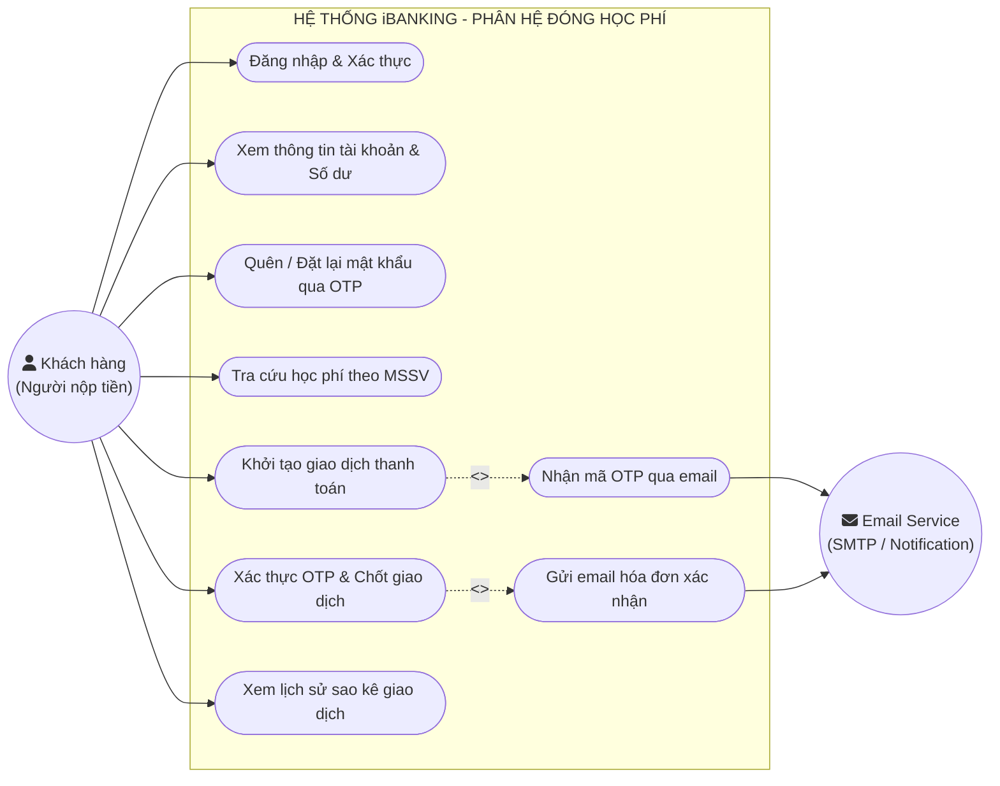
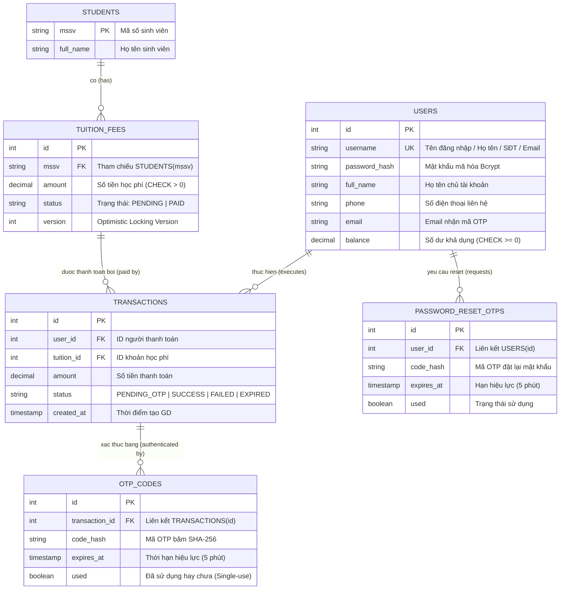
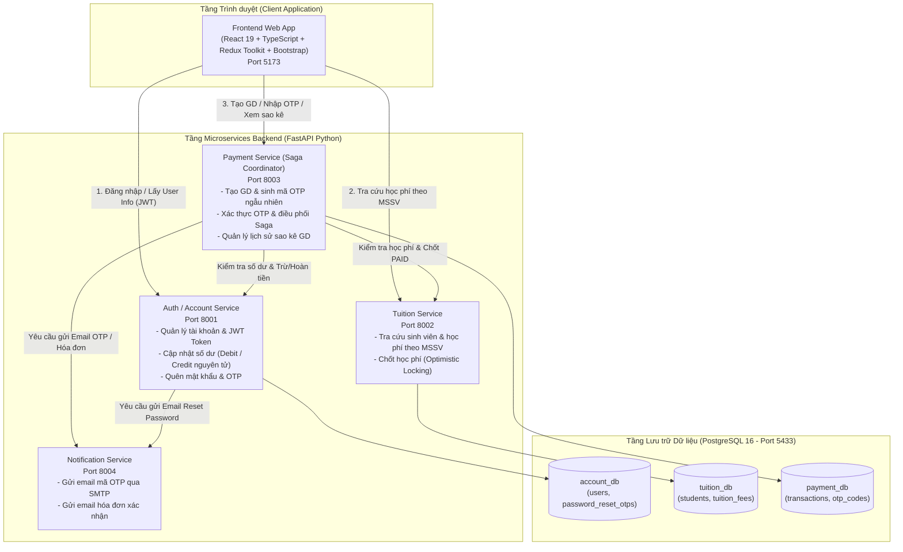

# Sơ đồ Kiến trúc & Thiết kế Hệ thống iBanking

Tài liệu này tổng hợp toàn bộ các sơ đồ đặc tả kỹ thuật theo đúng thang tiêu chí đánh giá môn học (10.0 / 10.0 điểm), bao gồm:
1. **Sơ đồ Ca sử dụng (Use Case Diagram)** - *Tiêu chí 1 (0.5đ)*
2. **Sơ đồ Thực thể Mối quan hệ (Entity Relationship Diagram - ERD)** - *Tiêu chí 1 (0.5đ) & Tiêu chí 4 (1.0đ)*
3. **Sơ đồ Kiến trúc Microservices (Microservices Architecture Diagram)** - *Tiêu chí 2 (1.5đ)*
4. **Sơ đồ Tuần tự Giao dịch & Xử lý Đồng thời (Saga Concurrency Sequence Diagram)** - *Tiêu chí 6 (1.5đ)*

---

## 1. Sơ đồ Ca sử dụng (Use Case Diagram)

Hệ thống phục vụ 2 tác nhân (Actors):
- **Khách hàng / Người nộp tiền (User)**: Sinh viên hoặc phụ huynh thực hiện đăng nhập, kiểm tra số dư, tra cứu học phí sinh viên theo MSSV, thực hiện nộp tiền qua mã OTP bảo mật và xem lịch sử giao dịch.
- **Dịch vụ Thông báo / Email (Notification Service / SMTP)**: Hệ thống ngoài nhận lệnh gửi OTP và hóa đơn điện tử.

---

## 2. Sơ đồ Thực thể Mối quan hệ (ERD - Entity Relationship Diagram)

Sơ đồ quan hệ thực thể chuẩn hóa bám sát cấu trúc cơ sở dữ liệu của đồ án:

### Phân rã Cơ sở dữ liệu theo Microservices (Database-per-Service)
Để đảm bảo tính độc lập và khả năng mở rộng (Scale-out):
- **`account_db`**: Chứa bảng `users`, `password_reset_otps`.
- **`tuition_db`**: Chứa bảng `students`, `tuition_fees`.
- **`payment_db`**: Chứa bảng `transactions`, `otp_codes`.
*(Khóa ngoại giữa `transactions` và `users`/`tuition_fees` là liên kết logic cấp ứng dụng (Logical Cross-Service Reference), tuân thủ nghiêm ngặt nguyên lý Microservices).*

---

## 3. Sơ đồ Kiến trúc Microservices (Microservices Architecture Diagram)

Hệ thống được tổ chức thành 4 Microservices độc lập và 1 Frontend Web Application:

---

## 4. Sơ đồ Tuần tự Giao dịch & Xử lý Đồng thời (Saga Concurrency Sequence)

Xử lý đồng thời (Concurrency Control) và bảo đảm toàn vẹn giao dịch (Data Consistency) được giải quyết qua 2 cơ chế:
1. **Kiểm soát số dư tài khoản**: Dùng câu lệnh SQL nguyên tử `UPDATE users SET balance = balance - :amount WHERE id = :id AND balance >= :amount`, kết hợp ràng buộc `CHECK (balance >= 0)`.
2. **Kiểm soát học phí**: Sử dụng **Optimistic Concurrency Control (OCC)** với cột `version` (`UPDATE tuition_fees SET status='PAID', version=version+1 WHERE id=:id AND status='PENDING' AND version=:v`). Nếu xung đột, Saga Coordinator tự động kích hoạt **Compensating Transaction** để hoàn tiền vào tài khoản người nộp.

---

## 5. File vẽ Draw.io sẵn sàng trình chiếu

File vẽ chi tiết đã được cập nhật tại:
`docs/ibanking-diagrams.drawio`

Để mở và chỉnh sửa trên giao diện kéo thả trực quan:
1. Mở trình duyệt truy cập: [https://app.diagrams.net](https://app.diagrams.net)
2. Chọn **Open Existing Diagram** -> Chọn file `docs/ibanking-diagrams.drawio` trong thư mục dự án.
3. Toàn bộ các tab sơ đồ (Use Case, Microservices, Sequence, ERD) đã được thiết kế sẵn và tương thích 100%.
