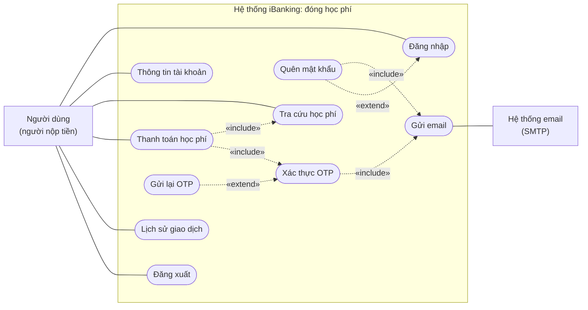
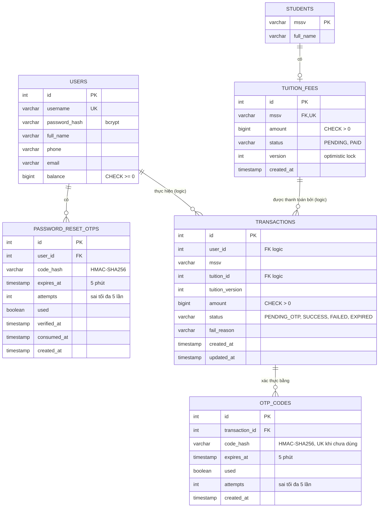
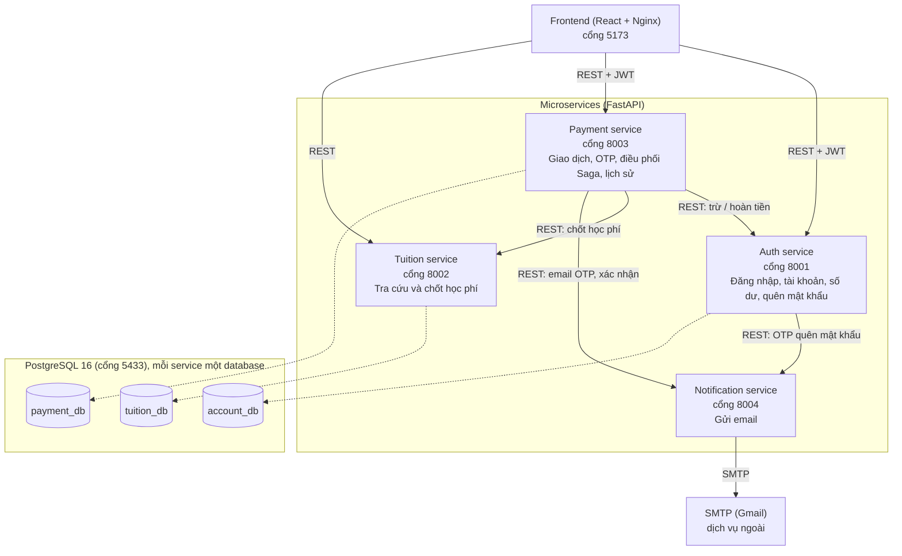
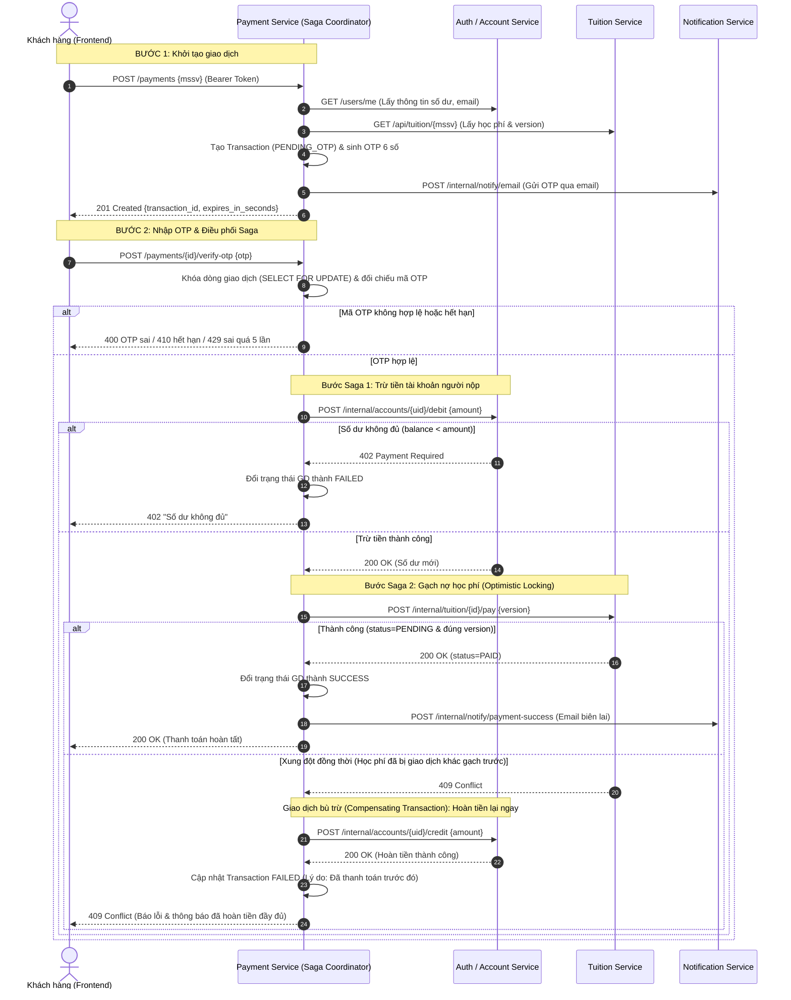

# Sơ đồ thiết kế hệ thống iBanking

Tài liệu tổng hợp các sơ đồ của phân hệ đóng học phí:

1. Sơ đồ Use Case (tiêu chí 1)
2. Sơ đồ ERD (tiêu chí 1 và 4)
3. Sơ đồ kiến trúc Microservices (tiêu chí 2)
4. Sơ đồ tuần tự giao dịch và xử lý đồng thời (tiêu chí 6)

Bản vẽ gốc dùng để trình chiếu là `docs/ibanking-diagrams.drawio` (3 trang: Use Case, ERD, Microservices Architecture). Các sơ đồ mermaid dưới đây có cùng nội dung để xem trực tiếp trên GitHub.

---

## 1. Sơ đồ Use Case

Tác nhân:

- **Người dùng (người nộp tiền):** đăng nhập, xem thông tin tài khoản, tra cứu và thanh toán học phí cho mình hoặc cho sinh viên khác, xem lịch sử giao dịch, quên mật khẩu, đăng xuất.
- **Hệ thống email (SMTP):** tác nhân ngoài, nhận email OTP và email xác nhận.

Quan hệ:

- *Thanh toán học phí* «include» *Tra cứu học phí* và *Xác thực OTP*.
- *Xác thực OTP* và *Quên mật khẩu* «include» *Gửi email*.
- *Quên mật khẩu* «extend» *Đăng nhập*; *Gửi lại OTP* «extend» *Xác thực OTP*.

---

## 2. Sơ đồ ERD

Sơ đồ khớp với `database/init.sql`. Mỗi service sở hữu một database riêng:

- **`account_db`**: `users`, `password_reset_otps`
- **`tuition_db`**: `students`, `tuition_fees`
- **`payment_db`**: `transactions`, `otp_codes`

Quan hệ trong cùng một database dùng khóa ngoại thật. `transactions.user_id` và `transactions.tuition_id` là liên kết logic sang database khác (không có khóa ngoại thật), Payment Service kiểm tra qua API.

---

## 3. Sơ đồ kiến trúc Microservices

Frontend gọi API bằng JWT; các service gọi nhau qua endpoint `/internal/*` với header `X-Internal-Key`. Payment Service điều phối giao dịch (Saga có bù trừ). Toàn bộ hệ thống chạy bằng Docker Compose (6 container).

---

## 4. Sơ đồ Tuần tự Giao dịch & Xử lý Đồng thời (Saga Concurrency Sequence)

Xử lý đồng thời (Concurrency Control) và bảo đảm toàn vẹn giao dịch (Data Consistency) được giải quyết qua 2 cơ chế:
1. **Kiểm soát số dư tài khoản**: Dùng câu lệnh SQL nguyên tử `UPDATE users SET balance = balance - :amount WHERE id = :id AND balance >= :amount`, kết hợp ràng buộc `CHECK (balance >= 0)`.
2. **Kiểm soát học phí**: Sử dụng **Optimistic Concurrency Control (OCC)** với cột `version` (`UPDATE tuition_fees SET status='PAID', version=version+1 WHERE id=:id AND status='PENDING' AND version=:v`). Nếu xung đột, Saga Coordinator tự động kích hoạt **Compensating Transaction** để hoàn tiền vào tài khoản người nộp.

---

## 5. File draw.io

Bản vẽ gốc: `docs/ibanking-diagrams.drawio`, gồm 3 trang **1. Use Case**, **2. ERD**, **3. Microservices Architecture**. Sơ đồ tuần tự chỉ có ở dạng mermaid trong file này.

Mở bằng https://app.diagrams.net → **Open Existing Diagram**. Để xuất ảnh: chọn trang, **File → Export as → PNG** (zoom 200%). Ảnh dùng trong repo: `docs/erd.png` (trang ERD), `docs/architecture.png` (trang kiến trúc).
